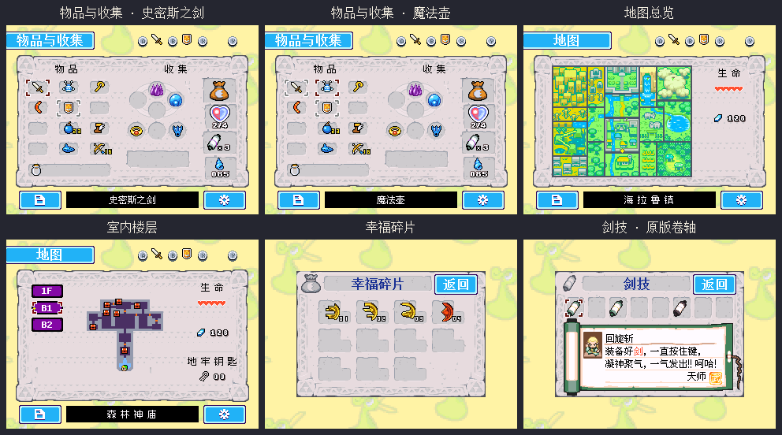

# 塞尔达传说：缩小帽 3DS 简体中文版

《塞尔达传说：缩小帽》的 Nintendo 3DS 原生双屏移植版，提供简体中文下屏界面，并支持 Angel Team SP4 汉化版。

> [!IMPORTANT]
> **要玩中文剧情，必须自备已应用 Angel Team SP4 汉化补丁的 `.gba` ROM。** 下载安装 CIA 后，还要把汉化 ROM 放进 SD 卡的指定目录。CIA 负责 3DS 移植和下屏中文界面，游戏剧情、对话和游戏内文本由 SP4 ROM 提供。本项目的下载包不包含 ROM 或汉化补丁。

[下载最新正式版 JP CIA](https://github.com/frilxy/zelda-tmc-3ds-cn/releases/latest) · [查看全部版本](https://github.com/frilxy/zelda-tmc-3ds-cn/releases) · [正式版对应源码](https://github.com/frilxy/zelda-tmc-3ds-cn/tree/v2.2.15)

## 安装和 ROM

1. 在发布页下载 `tmc-3ds-v<版本>.cia`，用 FBI 安装。也可以在 FBI 中选择 `Remote Install → Scan QR Code`，扫描发布页的二维码。
2. 在 SD 卡上建立目录 `sdmc:/3ds/The Minish Cap 3DS/`。
3. 将自行合法取得的 **Angel Team SP4 汉化 ROM** 放进该目录，然后启动游戏。文件名可自定，扩展名须为 `.gba`。

发布页的 JP CIA 支持以下两个 ROM。程序通过哈希识别 ROM，两个版本分别保存进度。

| ROM | 游戏内语言 | SHA-1 |
|---|---|---|
| **Angel Team SP4 汉化 ROM** | **简体中文** | `ba04cfbe93d12d2ad684c52234472fa12a5b53d7` |
| 日版原版 ROM | 日文 | `6c5404a1effb17f481f352181d0f1c61a2765c5d` |

请核对 SP4 的修订版本。改文件名不会改变 ROM 的识别结果。美版和欧版需要相应区域基线的构建。 [3DS 平台说明](platform/3ds/README.md)

## 双屏操作

| 操作 | 下屏行为 |
|---|---|
| 进入游戏 | 默认显示地图。底部黑栏显示当前位置，右侧显示生命、卢比和适用地牢的钥匙。 |
| 按 START 或点左上页签 | 在「地图」与「物品与收集」之间切换，游戏继续运行。 |
| 点道具，再按实体 A／B／X／Y | 黑栏显示 ROM 里的道具名称，按键将选中的道具绑到对应位置。 |
| 点击地图区域 | 打开区域详情。可拖动查看，点击右侧「返回」回到总览。进入地牢时显示楼层图，名称位于底部。 |
| 点击幸福碎片袋或剑技卷轴 | 打开收集详情。点已学剑技查看原版卷轴，两个详情页的返回按钮都在石板右上角。 |

## 显示设置

在下屏打开「设置 → 屏幕」。启动或标题界面也可点下屏的三角力量进入设置。

| 想要的效果 | 设置方式 |
|---|---|
| 400×240 Full View | 「宽高比」选「宽屏」，「显示方式」选「点对点」。画面会在适用场景扩展视野，小房间可显示相连区域。 |
| AI 补景 | 「宽高比」选「宽屏+AI」，「显示方式」选「点对点」。补景适用于标题、选档、部分缩小传送和小人路径等场景。 |
| 原版画幅 | 「宽高比」选「原始」。显示方式可选「模糊」「双线性」或「点对点」。旧版的「拉伸」设置会按普通宽屏读取。 |
| 裸眼立体 3D | 调高支持立体显示的 3DS 主机的 3D 滑杆。打开「3D景深」，可为部分场景和角色增加景深。 |

## 各项功能的来源

| 功能 | 来源 |
|---|---|
| GBA 游戏反编译、原生引擎 | `zeldaret/tmc` 提供反编译基础，Project Picori 提供原生引擎和移植基础。 [zeldaret/tmc](https://github.com/zeldaret/tmc) · [Project Picori](https://github.com/999sian/tmc) |
| 双屏地图、任务状态与触屏道具 | 双屏设计沿用 `samyost1/tmc-android`，Raekwon1603 参与 Android 打包和平台工作，EstebanPdN 将双屏方案移植到 Nintendo 3DS。 [Android 双屏移植](https://github.com/samyost1/tmc-android) · [Android 平台改动](https://github.com/Raekwon1603/tmc-android) · [原始 3DS 移植](https://github.com/EstebanPdN/zelda-tmc-3ds) |
| 原生 3DS 输入和音频、机型性能配置、诊断、应用内更新 | 源自 EstebanPdN 的 3DS 移植。本仓库的更新器跟踪自己的发布页。 [上游 v2.2](https://github.com/EstebanPdN/zelda-tmc-3ds/tree/v2.2) |
| Full View、相邻房间、裸眼立体 3D、GPU 改进、启动动画、X／Y 道具键 | 移植自 `tinaut1986` 的 `v0.4.7`。该 fork 还提供了 AI 补景资源，以及本仓库采用的宽屏剧情走位、丘丘特效、睡眠气泡及脚本上下文修复。 [tinaut1986 v0.4.7](https://github.com/tinaut1986/zelda-tmc-3ds/tree/v0.4.7) · [移植 PR](https://github.com/frilxy/zelda-tmc-3ds-cn/pull/34) |
| 游戏剧情、对话和游戏内文本的简体中文翻译 | 由 **Angel Team SP4 汉化组**提供。程序从用户放入的 SP4 ROM 读取文本，并按其编码显示。 [ROM 识别与文本配置](https://github.com/frilxy/zelda-tmc-3ds-cn/blob/v2.2.15/port/port_rom_profile.c) |
| SP4 兼容、中文下屏和布局、独立存档 | 本仓库适配 SP4 的 ROM 识别和文本编码，汉化下屏菜单、地图及设置，调整字库、按钮和卢比位置，并区分原版日版与 SP4 的存档。下屏采用 Fusion Pixel 和 GNU Unifont 字形。 [正式版更新日志](https://github.com/frilxy/zelda-tmc-3ds-cn/blob/v2.2.15/CHANGELOG-cn.md) · [字库与授权](FONT-NOTICE.md) |
| 随机化模式 | 沿用 Project Picori 的原生随机化模块，其规则和道具池源自 Minish Maker Randomizer。正常与随机化进度分开保存。 [随机化模块说明](port/rando/README.md) · [Minish Maker Randomizer](https://github.com/minishmaker/randomizer) |

## 更新与反馈

- 应用内打开「设置 → 更新」，可选择正式版或预发布通道。更新日志在下屏查看，上屏继续显示游戏画面。安装前请先保存游戏，更新成功后应用会退出。发布页也提供 FBI 二维码和 SHA-256 校验清单。 [发布页](https://github.com/frilxy/zelda-tmc-3ds-cn/releases)
- 遇到画面、性能或崩溃问题时，可在游戏仍响应时按 `L + R + A` 写入诊断资料。提交反馈时请附版本号、主机型号、ROM 类型、复现步骤，以及 `sdmc:/3ds/The Minish Cap 3DS/dumps/` 中的对应诊断目录。 [提交问题](https://github.com/frilxy/zelda-tmc-3ds-cn/issues) · [Discord](https://discord.gg/SMW49UMkw)
- 自行构建请从发行标签检出对应源码，并参照平台说明。正式版构建输出 CIA。 [3DS 平台说明](platform/3ds/README.md)

## 许可

本项目是非官方同人移植，与 Nintendo 无隶属关系。游戏及相关内容的权利归 Nintendo 等权利人所有。项目源码采用 GPL-3.0，第三方代码、字体与库各自遵循对应许可。 [项目许可](LICENSE) · [第三方许可](THIRD-PARTY-LICENSES.md)
